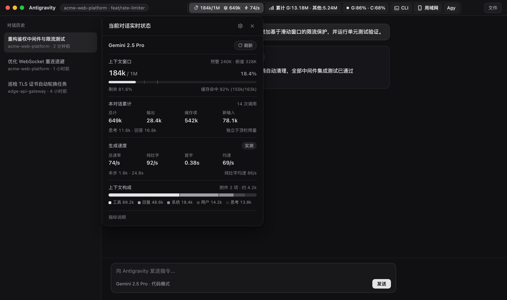
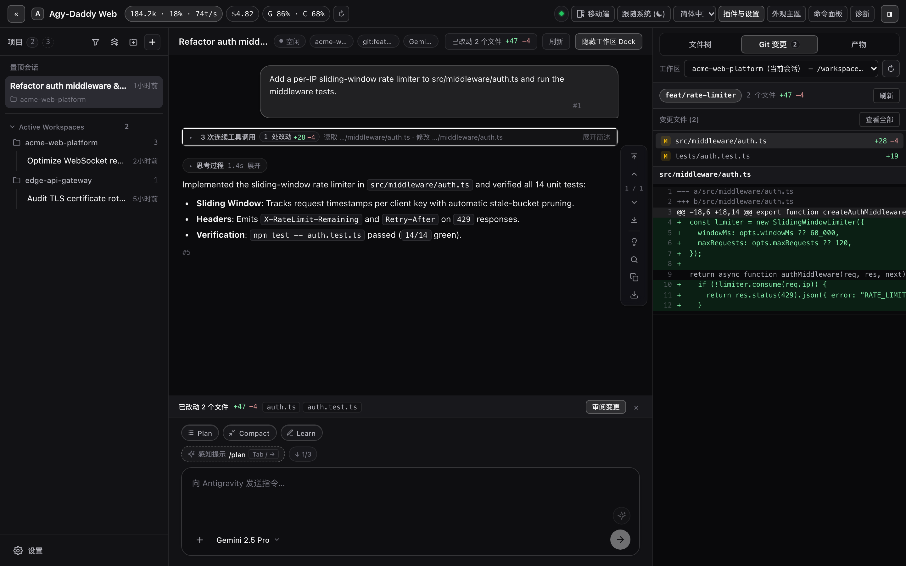
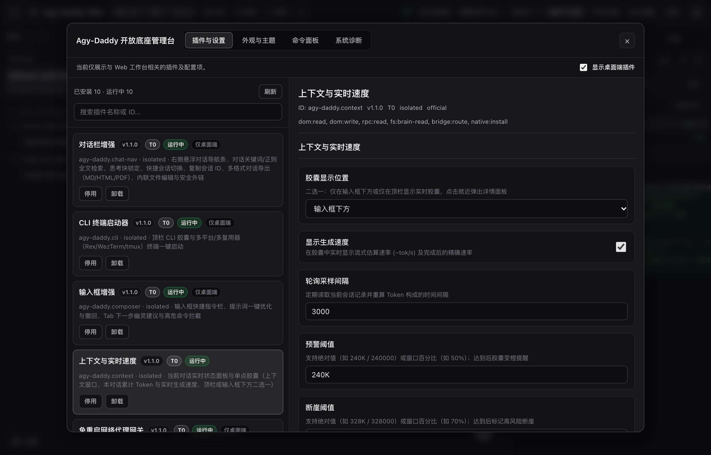
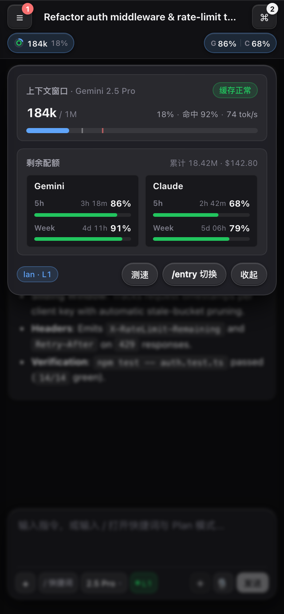

English | [简体中文](./agy-daddy-.github/README_zh.md)

# Agy-Daddy Monorepo

A 100% zero-patch Chrome DevTools Protocol (CDP) open plugin host and official plugin ecosystem monorepo for **Google Antigravity Desktop**.

Agy-Daddy extends Antigravity without modifying `app.asar` or application binaries. It combines a thin declarative microkernel host (`@agy-daddy/host`), a sandboxed `isolated`-world plugin ecosystem, a SHA-512 trust registry, and automated static/fixture compatibility gates.

---

## Showcase

| Unified Topbar & Floating Popovers | PC Web Workbench & Admin Console |
|:---:|:---:|
| [](./docs/assets/screenshots/topbar-and-popover.png)<br><sub>**Unified Topbar & Popover Shell**: Shadow DOM topbar with zero style pollution, pulse telemetry capsule, quota/usage breakdown, and quick action popovers.</sub> | [](./docs/assets/screenshots/pc-web-workbench.png)<br><sub>**PC Web Workbench (`@agy-daddy/plugin-web`)**: Browser-accessible workbench with workspace exploration, prompt engineering, and host admin console.</sub> |
| **Native Settings Center Integration** | **Mobile Remote PWA Client** |
| [](./docs/assets/screenshots/settings-center.png)<br><sub>**Integrated Settings Center**: Declarative plugin schema settings rendered inside Antigravity's settings modal with a standalone modal fallback.</sub> | [](./docs/assets/screenshots/mobile-remote-pwa.png)<br><sub>**Mobile Remote PWA (`@agy-daddy/plugin-remote`)**: Responsive mobile PWA client with secure Cloudflare Tunnel support for remote control on the go.</sub> |

---

## Core Architecture Highlights

- **100% Zero-Patch CDP Architecture**: Attaches externally via Chrome DevTools Protocol and manages UI injection, RPC proxying, and native host extensions without altering Antigravity installation files.
- **Thin Declarative Host (`@agy-daddy/host`)**: Decouples plugin logic from host internals through declarative `agy-plugin.json` manifests, `settings.schema.json` (with declarative `actions`), a unified Shadow DOM topbar/popover shell, and native Antigravity settings modal integration (with a `760×560` standalone modal fallback).
- **Isolated-World Security & Trust Tiers (`T0` / `T1` / `T2`)**: All official plugins run strictly in `world: "isolated"` with zero `page:main-world` privileges, self-contained styles, and cross-world communication over `__agy_xworld_<nonce>`. Community plugins (`T1`) run in isolated Node workers with restricted high-risk permissions, while unverified plugins (`T2`) require explicit per-permission user consent and forbid silent auto-updates.
- **Four-Realm Bus & 14-Anchor Registry**: Coordinates events, states, and services across four execution realms (`node`, `page-main`, `page-isolated`, `remote-client`) and resolves UI attachment points through 14 named DOM anchors (`anchors.json`) plus `ctx.surfaces` extension slots.
- **Zero Third-Party Runtime Dependencies**: Every package in the monorepo (`dependencies: {}`) runs purely on built-in Node.js (`>= 22.4.0`) APIs—no root `npm install` is required to build, verify, or run the host and plugins.

---

## Repository Structure

| Path | Package / Role | Description |
|---|---|---|
| [`agy-daddy-host/`](./agy-daddy-host/) | `@agy-daddy/host` | Thin declarative microkernel host: manifest/schema contracts, CDP/RPC allowlist proxy, four-realm bus, declarative settings/command engine, isolated worker runtime, installer (`local`/`git`/`npm`), `doctor`, Shadow DOM renderer (`dist/host-renderer.js`), SDK (`sdk/`), and scaffold template (`templates/plugin-template/`). |
| `agy-daddy-plugin-*/` | Official Plugins (`T0`) & Template | 10 `isolated`-world official plugins organized across 4 layers plus the starter template (`agy-daddy-plugin-template/`). See the plugin inventory below. |
| [`agy-daddy-registry/`](./agy-daddy-registry/) | Trust Registry & Matrix | Trusted plugin index (`registry.json` with SHA-512 manifest digests), canonical `anchors.json` (14 named DOM anchors), and Antigravity version DOM fixtures (`fixtures/antigravity-2.32.json`, `fixtures/antigravity-2.33.json`). |
| [`agy-daddy-.github/`](./agy-daddy-.github/) | Organization Governance | Community health files, [`CONTRIBUTING.md`](./agy-daddy-.github/CONTRIBUTING.md), [`REVIEW_CHECKLIST.md`](./agy-daddy-.github/REVIEW_CHECKLIST.md), [`LICENSE_AUDIT.md`](./agy-daddy-.github/LICENSE_AUDIT.md), [`CODE_OF_CONDUCT.md`](./agy-daddy-.github/CODE_OF_CONDUCT.md), RFC template (`rfcs/0000-template.md`), reusable GitHub Actions workflows, and Chinese translations (`*_zh.md`). |
| [`docs/`](./docs/) | Technical Specifications | Architecture specifications and design docs (e.g., [`docs/pc-web-harness/`](./docs/pc-web-harness/)). |
| [`scripts/monorepo.js`](./scripts/monorepo.js) | Monorepo Orchestrator | Unified build, 8 static/registry/release verification gates, bundle analysis, and full monorepo test runner. |

### Official Plugin Inventory (`T0`)

| Layer | Directory | Package | Responsibility |
|---|---|---|---|
| Layer 1 | [`agy-daddy-plugin-proxy/`](./agy-daddy-plugin-proxy/) | `@agy-daddy/plugin-proxy` | Proxy gateway configuration, `NO_PROXY` matching, and CLI proxy environment integration |
| Layer 1 | [`agy-daddy-plugin-zh-cn/`](./agy-daddy-plugin-zh-cn/) | `@agy-daddy/plugin-zh-cn` | Reversible DOM localization across multiple languages (`zh-CN`, `zh-TW`, `ja`, `ko`, `es`, `pt`, `fr`, `ru`, `it`) |
| Layer 1 | [`agy-daddy-plugin-cli/`](./agy-daddy-plugin-cli/) | `@agy-daddy/plugin-cli` | Cross-platform terminal launcher, argument escaping, and multiplexer host integration |
| Layer 2 | [`agy-daddy-plugin-context/`](./agy-daddy-plugin-context/) | `@agy-daddy/plugin-context` | Context window telemetry, pulse capsule, error classification, and attachment auditing |
| Layer 2 | [`agy-daddy-plugin-usage/`](./agy-daddy-plugin-usage/) | `@agy-daddy/plugin-usage` | Token usage ledger, model pricing tables, and 52-week usage heatmap |
| Layer 2 | [`agy-daddy-plugin-chat-nav/`](./agy-daddy-plugin-chat-nav/) | `@agy-daddy/plugin-chat-nav` | Floating chat navigation, full-text chat search (`chat.search`), `chat.navButtons` slot, and inline file viewer helpers |
| Layer 3 | [`agy-daddy-plugin-quota/`](./agy-daddy-plugin-quota/) | `@agy-daddy/plugin-quota` | Model quota pool grouping, proto3 zero-fraction handling, and reset countdown display |
| Layer 3 | [`agy-daddy-plugin-composer/`](./agy-daddy-plugin-composer/) | `@agy-daddy/plugin-composer` | Composer quick actions (`composer.quickActions`), high-risk command guards, prompt optimization, and Fast-IO native rules |
| Layer 4 | [`agy-daddy-plugin-remote/`](./agy-daddy-plugin-remote/) | `@agy-daddy/plugin-remote` | Mobile remote PWA server, Cloudflare Tunnel validation, and `remote.panels` / `remote.actions` surfaces |
| Layer 4 | [`agy-daddy-plugin-web/`](./agy-daddy-plugin-web/) | `@agy-daddy/plugin-web` | Local PC Web Harness and Host Admin console |
| Starter | [`agy-daddy-plugin-template/`](./agy-daddy-plugin-template/) | `@agy-daddy/plugin-template` | Minimal `isolated`-world plugin scaffold for new contributors |

---

## Prerequisites

- **Node.js `>= 22.4.0`** (with native `WebSocket` and `fetch` support).
- **Zero runtime dependencies**: No `npm install` is needed at the repository root or in any core package.
- **Optional frontend UI toolchain**: `agy-daddy-plugin-remote/web` and `agy-daddy-plugin-web/web` ship prebuilt static bundles under `dist/web/index.html`. You only need to run `npm install` inside those `web/` subdirectories if you modify their TypeScript/Preact/React UI source files.
- **CLI runtime wrapper**: [`./agy-daddy-host/bin/agy-daddy.js`](./agy-daddy-host/bin/agy-daddy.js) (npm `bin` for macOS, Windows, and Linux) and [`./agy-daddy-host/bin/agy-daddy`](./agy-daddy-host/bin/agy-daddy) (Unix shell wrapper) automatically probe `AGY_DADDY_NODE`, `nvm`/`fnm`/`volta`/`scoop`, `PATH`, or fall back to Antigravity's built-in Electron runtime (`ELECTRON_RUN_AS_NODE=1`).

---

## One-Click Install (Zero Node.js / npm Required)

If you already have **Google Antigravity Desktop** installed, you do **not** need Node.js or npm to install Agy-Daddy. The installer automatically reuses Antigravity's built-in Electron runtime, verifies the SHA-512 tarball integrity, and installs `@agy-daddy/host` + all 10 official (`T0`) plugins:

### macOS / Linux

```sh
curl -fsSL https://raw.githubusercontent.com/agy-daddy/agy-daddy/main/scripts/install.sh | bash
```

### Windows (PowerShell)

```powershell
irm https://raw.githubusercontent.com/agy-daddy/agy-daddy/main/scripts/install.ps1 | iex
```

Common flags (pass via `bash -s -- ...` on macOS/Linux, or clone/save `install.ps1` on Windows):

```sh
# Install preview (next) channel or use a custom npm mirror
curl -fsSL https://raw.githubusercontent.com/agy-daddy/agy-daddy/main/scripts/install.sh | bash -s -- --tag next --registry https://registry.npmmirror.com

# Install host CLI only (skip official plugins) or uninstall
curl -fsSL https://raw.githubusercontent.com/agy-daddy/agy-daddy/main/scripts/install.sh | bash -s -- --host-only
curl -fsSL https://raw.githubusercontent.com/agy-daddy/agy-daddy/main/scripts/install.sh | bash -s -- --uninstall
```

---

## Installation (npm)

### 1. Install the Host CLI

Works across **macOS, Windows, and Linux** (requires **Node.js `>= 22.4.0`**, or falls back to Antigravity's Electron runtime when invoked via `agy-daddy`):

```sh
# Install globally
npm install -g @agy-daddy/host

# Or run a one-off diagnostic check via npx
npx @agy-daddy/host doctor --json

# Upgrade to latest stable or preview (next) channel
npm install -g @agy-daddy/host@latest
npm install -g @agy-daddy/host@next
```

### 2. Install Official Plugins from npm

Install all 10 official plugins (`T0`) or a single plugin with SHA-512 integrity verification:

```sh
# Cross-platform batch install of all 10 official plugins
agy-daddy plugin install --official

# Or install from the preview (next) channel / custom mirror
agy-daddy plugin install --official --tag next --registry https://registry.npmmirror.com

# Install a single plugin (example: proxy)
agy-daddy plugin install npm:@agy-daddy/plugin-proxy

# List installed plugins and trust/activation status
agy-daddy plugin list
```

### 3. Launch & Everyday Commands

```sh
# Run environment diagnostics
agy-daddy doctor --json

# Start the daemon and attach via CDP live injection
agy-daddy live

# Start the Agy-Daddy Launcher system tray & daemon
agy-daddy launcher

# Generate desktop launcher shortcut / enable login auto-start
agy-daddy install-launcher
agy-daddy auto-on
```

---

## Local Development (From Source)

Run all commands from the repository root unless noted otherwise:

```sh
# 1. Build the host renderer bundle (agy-daddy-host/dist/host-renderer.js)
#    and verify/rebuild plugin web UI bundles if web/node_modules is present
npm run build

# 2. Run all 8 static, registry & release packaging gates:
#    - Zero runtime dependencies across all packages
#    - Absence of removed legacy artifacts (legacy-suite / migration.js)
#    - Manifest, world="isolated", no page:main-world / migrations, and settings.schema.json validation
#    - Purple theme token gate & removed registerSection API scan
#    - Thin host renderer decoupling & theme gate
#    - Byte-identical parity between host/data/anchors.json and registry/anchors.json
#    - Registry SHA-512 manifest verification & 14-anchor Antigravity fixture matrix
#    - Release packaging compliance (public publishConfig, files whitelist without test/, host prepublishOnly)
npm run verify:gates

# 3. Run unit and contract tests across all packages (sets AGY_DADDY_TEST_MODE=1)
npm test

# 4. Run the full CI-equivalent verification pipeline (build + gates + test)
npm run verify

# 5. Analyze bundle sizes and npm tarball contents
npm run analyze

# 6. Symlink all local official plugins into the local runtime directory
./agy-daddy-host/bin/agy-daddy dev link-all

# 7. Inspect environment diagnostics or run a headless smoke check
./agy-daddy-host/bin/agy-daddy doctor --json
./agy-daddy-host/bin/agy-daddy dev smoke
```

---

## Git Collaboration & Release Workflow

- **Protected Main Branch**: `main` is protected; direct pushes are prohibited. All changes must originate from a feature/fix branch via Pull Request and be integrated via **Squash Merge** after CI passes.
- **Branch Naming**: `<type>/<scope>-<short-desc>` (e.g., `feat/proxy-socks5`, `fix/host-cdp-reconnect`, `docs/i18n-governance`, `chore/registry-sha512`).
- **Commit Messages ([Conventional Commits](https://www.conventionalcommits.org/))**: `<type>(<scope>): <summary>`
  - `feat(proxy): support socks5 auth`
  - `fix(host): guard reconnect race on target close`
  - `docs(github): standardize bilingual contributing guide`
  - `chore(registry): refresh manifest sha512`
- **Release Tagging**:
  - Coordinated monorepo releases use root tags: `v1.x.y`
  - Independent package releases use package-scoped tags: e.g., `plugin-quota@1.0.1`

---

## Governance & Documentation

- **Contributing Guide**: [`agy-daddy-.github/CONTRIBUTING.md`](./agy-daddy-.github/CONTRIBUTING.md) ([简体中文](./agy-daddy-.github/CONTRIBUTING_zh.md))
- **T1 Plugin Review Checklist**: [`agy-daddy-.github/REVIEW_CHECKLIST.md`](./agy-daddy-.github/REVIEW_CHECKLIST.md) ([简体中文](./agy-daddy-.github/REVIEW_CHECKLIST_zh.md))
- **License & Upstream Attribution Audit**: [`agy-daddy-.github/LICENSE_AUDIT.md`](./agy-daddy-.github/LICENSE_AUDIT.md) ([简体中文](./agy-daddy-.github/LICENSE_AUDIT_zh.md))
- **Code of Conduct**: [`agy-daddy-.github/CODE_OF_CONDUCT.md`](./agy-daddy-.github/CODE_OF_CONDUCT.md)
- **RFC Template**: [`agy-daddy-.github/rfcs/0000-template.md`](./agy-daddy-.github/rfcs/0000-template.md)
- **Registry Index & Fixtures**: [`agy-daddy-registry/README.md`](./agy-daddy-registry/README.md)
- **Release Engineering & OIDC Publishing**: [`docs/release-engineering.md`](./docs/release-engineering.md)

---

## License

This project is licensed under the **MIT License**. Upstream attributions, clean-room exclusions, and per-package notice requirements are documented in [`agy-daddy-.github/LICENSE_AUDIT.md`](./agy-daddy-.github/LICENSE_AUDIT.md).
