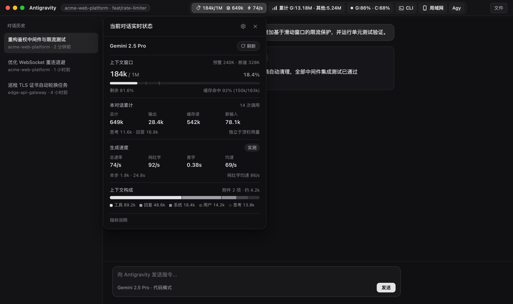
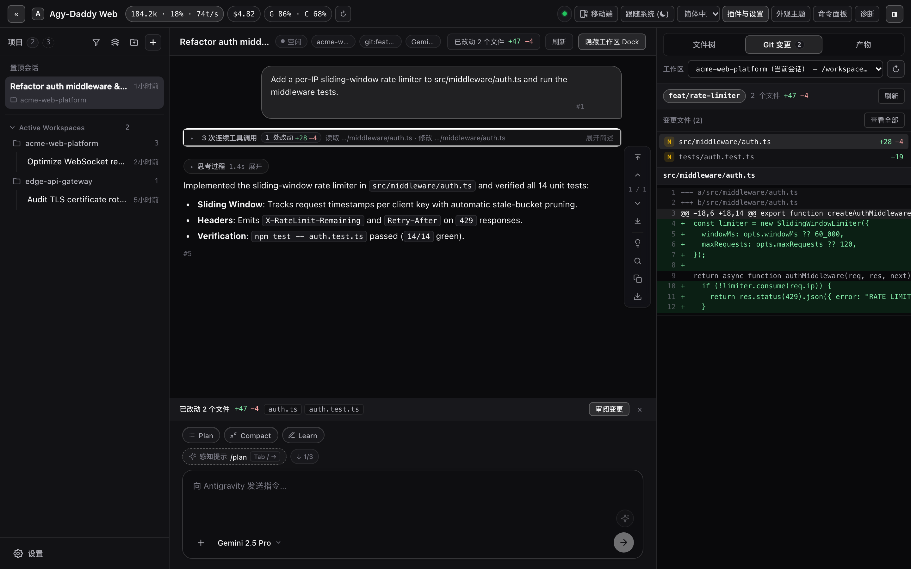
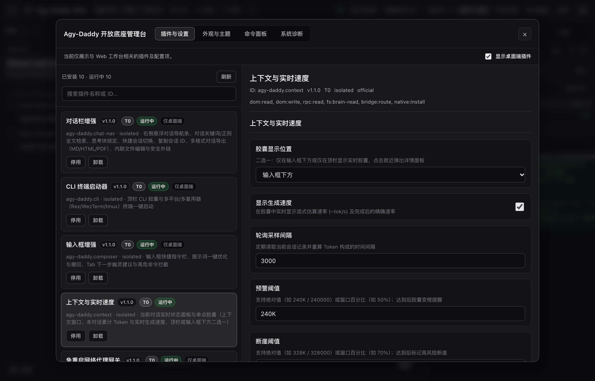
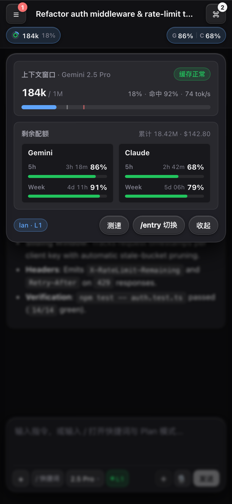

[English](../README.md) | 简体中文

# Agy-Daddy Monorepo

面向 **Google Antigravity 桌面端**的 100% 零改包 Chrome DevTools Protocol（CDP）开放插件底座与官方插件生态单仓（Monorepo）。

Agy-Daddy 无需修改 `app.asar` 或应用二进制文件即可扩展 Antigravity。仓库将纯净声明式微内核底座（`@agy-daddy/host`）、`isolated` 隔离世界插件生态、SHA-512 信任注册表以及自动化静态/夹具兼容门禁整合于同一代码库中。

---

## 界面展示

| 统一顶栏与悬浮 Popover 弹层 | PC Web 工作台与控制台 |
|:---:|:---:|
| [](../docs/assets/screenshots/topbar-and-popover.png)<br><sub>**统一顶栏与 Popover 包壳**：Shadow DOM 隔离无样式污染、底部脉冲遥测胶囊、配额与用量多维度账本弹层及快捷操作中心。</sub> | [](../docs/assets/screenshots/pc-web-workbench.png)<br><sub>**PC Web 工作台（`@agy-daddy/plugin-web`）**：支持多通道访问的独立浏览器端工作台，集成工作区探索、会话调试与底座管控台。</sub> |
| **原生设置中心融合** | **移动端远程 PWA 客户端** |
| [](../docs/assets/screenshots/settings-center.png)<br><sub>**声明式设置中心**：全托管 `settings.schema.json` 融合渲染于 Antigravity 原生设置弹窗，并提供独立模态窗安全降级。</sub> | [](../docs/assets/screenshots/mobile-remote-pwa.png)<br><sub>**移动端远程 PWA（`@agy-daddy/plugin-remote`）**：响应式移动端控制台，配合安全 Cloudflare Tunnel 隧道实现随时随地远程接管。</sub> |

---

## 功能亮点（Why Agy-Daddy？）

- **100% 零改包 CDP 架构**：非侵入式架构设计。完全通过 Chrome DevTools Protocol 外部非侵入挂载，不修改 `app.asar` 或任何底层应用二进制，Antigravity 升级官方客户端无破坏风险。
- **免装 Node.js / npm 开箱即用**：无需预先配置 Node.js 开发环境。提供三平台包装器，首次启动自动复用 Antigravity 自带的 Electron 运行时安装 `@agy-daddy/host` 与官方插件，小白用户解压即用。
- **10 大官方 `T0` 插件矩阵**：开箱即用覆盖生产力全链路，包含网络代理（Proxy）、多语言本地化（zh-CN）、跨端终端（CLI）、上下文遥测（Context）、用量账本（Usage）、对话导航与全文检索（Chat-Nav）、模型配额监控（Quota）、输入框增强与提示词优化（Composer）、移动端远程控制（Remote PWA）与 PC 浏览器工作台（Web）。
- **跨平台系统托盘 Launcher**：macOS、Windows 与 Linux 托盘常驻，支持一键启动增强版 Antigravity、即时呼出声明式插件设置中心与守护进程管理。
- **PC Web 工作台 + 手机 Remote PWA 双端协同**：大屏端提供 PC 浏览器独立工作台（`@agy-daddy/plugin-web`）进行多会话探索与底座管理；移动端提供 Remote PWA（`@agy-daddy/plugin-remote`）结合 Cloudflare Tunnel 隧道随时远程接管。
- **隔离世界安全与 `T0`/`T1`/`T2` 信任分级体系**：全员官方插件严格运行在 Chrome `isolated` 隔离世界中，样式自封装不污染主界面。通过透明的三级信任治理（`T0` 官方直属认证、`T1` 社区审查沙箱 Worker 运行、`T2` 未审第三方逐项权限弹窗确认）确保工作区资产与密钥绝对安全。

---

## 下载与安装指南

### 方式一：三平台包装器直接下载（新手首选，免装 Node.js / npm）

新手最简单直接的使用方式。**无需在本机安装 Node.js 或 npm**，下载解压对应平台包即可直接使用原生启动器与桌面整合能力。

#### 下载直链清单

| 平台 / 用途 | 资产文件名 | 固定下载直链 |
|---|---|---|
| **macOS 包装器**（Universal 14+） | `agy-daddy-launcher-macos.zip` | [下载 macOS ZIP](https://github.com/agy-daddy/agy-daddy/releases/latest/download/agy-daddy-launcher-macos.zip) |
| **Windows 包装器**（x64 / ARM64） | `agy-daddy-launcher-windows.zip` | [下载 Windows ZIP](https://github.com/agy-daddy/agy-daddy/releases/latest/download/agy-daddy-launcher-windows.zip) |
| **Linux 包装器**（x64 / ARM64） | `agy-daddy-launcher-linux.tar.gz` | [下载 Linux tar.gz](https://github.com/agy-daddy/agy-daddy/releases/latest/download/agy-daddy-launcher-linux.tar.gz) |
| **SHA-256 校验和清单** | `agy-daddy-wrappers-sha256sums.txt` | [下载 SHA256SUMS](https://github.com/agy-daddy/agy-daddy/releases/latest/download/agy-daddy-wrappers-sha256sums.txt) |

> **提示**：上述固定直链将在下一个包含包装器的正式版本 tag（如 `v1.1.1`）发布后正式生效。你也可以随时访问 [GitHub Releases](https://github.com/agy-daddy/agy-daddy/releases) 页面浏览和下载历史版本。
>
> **SHA-256 校验示例**：
> ```sh
> # macOS / Linux
> shasum -a 256 -c agy-daddy-wrappers-sha256sums.txt
> # Windows (PowerShell)
> Get-FileHash .\agy-daddy-launcher-windows.zip -Algorithm SHA256
> ```

#### 各平台首次运行指引

**通用前提**：本机先安装 **Google Antigravity 桌面端**，将下载的压缩包**完整解压**后运行。首次启动需要保持网络连接（会自动复用 Antigravity 内置 Electron 运行时安装 `@agy-daddy/host` 与官方插件，全程无需 Node.js / npm）。

- **macOS（Universal 14+ 双架构）**：
  1. 解压 `agy-daddy-launcher-macos.zip`。
  2. 双击 `Agy-Daddy Launcher.app` 静默启动并常驻顶部菜单栏托盘；若需在终端查看首次下载与安装输出，可双击运行 `Install & Launch.command`。
  3. *Gatekeeper 拦截处理*：由于包装器未签名，若 macOS Gatekeeper 提示拦截，在解压目录打开终端执行：
     ```sh
     xattr -cr 'Agy-Daddy Launcher.app' 'Install & Launch.command'
     ```
     执行后再打开应用即可。Finder 启动日志记录于 `~/Library/Logs/agy-daddy/wrapper.log`。
- **Windows（x64 / ARM64）**：
  1. 右键下载的 `agy-daddy-launcher-windows.zip`，选择「**全部解压缩**」（切勿直接在压缩包内双击运行）。
  2. 双击 `Agy-Daddy-Launcher.vbs` 在后台无控制台黑框启动；或双击 `Agy-Daddy-Launcher.cmd` 查看控制台日志（Windows Script Host 被禁用时亦可使用 `.cmd`）。
  3. *SmartScreen 提示处理*：若弹出 Microsoft Defender SmartScreen 提示，点击「**更多信息**」&rarr;「**仍要运行**」。
  4. *创建桌面快捷方式（可选）*：将解压目录移至固定存放位置后，在该目录下右键打开 PowerShell 执行：
     ```powershell
     powershell.exe -NoProfile -ExecutionPolicy Bypass -File .\Create-Desktop-Shortcut.ps1
     ```
     后台启动日志记录于 `%LOCALAPPDATA%\AgyDaddy\logs\wrapper.log`。
- **Linux（x64 / ARM64）**：
  1. 解压压缩包：`tar -xzf agy-daddy-launcher-linux.tar.gz`。
  2. 在解压目录赋予执行权限并启动：
     ```sh
     chmod +x agy-daddy-launcher.sh install-desktop-entry.sh && ./agy-daddy-launcher.sh
     ```
  3. *添加系统应用菜单入口（可选）*：将解压目录存放在固定路径后，运行 `./install-desktop-entry.sh` 写入 `~/.local/share/applications/agy-daddy-launcher.desktop`。
  4. *系统托盘环境要求*：需要支持系统托盘的桌面环境，并预装 Python 3 与 PyGObject + GTK 3（如 Debian/Ubuntu 下执行 `apt install python3-gi gir1.2-gtk-3.0`，或支持 AyatanaAppIndicator3）。

---

### 方式二：一键脚本安装（进阶 / 终端命令行）

只要本机已安装 **Google Antigravity 桌面端**，即可免装 Node.js 与 npm 在终端一键安装。安装脚本会自动复用 Antigravity 内置 Electron 运行时、校验 tarball SHA-512 完整性摘要，并安装 `@agy-daddy/host` 及全部 10 个官方（`T0`）插件：

#### macOS / Linux

```sh
curl -fsSL https://raw.githubusercontent.com/agy-daddy/agy-daddy/main/scripts/install.sh | bash
```

#### Windows (PowerShell)

```powershell
irm https://raw.githubusercontent.com/agy-daddy/agy-daddy/main/scripts/install.ps1 | iex
```

常用参数示例（macOS/Linux 通过 `bash -s -- ...` 传参，Windows 可保存 `install.ps1` 传参）：

```sh
# 安装预览版（next）或指定国内镜像源
curl -fsSL https://raw.githubusercontent.com/agy-daddy/agy-daddy/main/scripts/install.sh | bash -s -- --tag next --registry https://registry.npmmirror.com

# 仅安装底座 CLI（跳过官方插件）或卸载
curl -fsSL https://raw.githubusercontent.com/agy-daddy/agy-daddy/main/scripts/install.sh | bash -s -- --host-only
curl -fsSL https://raw.githubusercontent.com/agy-daddy/agy-daddy/main/scripts/install.sh | bash -s -- --uninstall
```

---

### 方式三：通过 npm 安装使用（开发者模式）

适合已有 Node.js（`>= 22.4.0`）开发环境的用户：

#### 1. 全局安装底座 CLI

```sh
# 全局安装底座 CLI
npm install -g @agy-daddy/host

# 或使用 npx 直接运行环境诊断
npx @agy-daddy/host doctor --json

# 升级到最新正式版（latest）或预览通道（next）
npm install -g @agy-daddy/host@latest
npm install -g @agy-daddy/host@next
```

#### 2. 从 npm 安装官方插件（`T0`）

```sh
# 跨平台一键安装全部 10 个官方插件
agy-daddy plugin install --official

# 指定预览通道或自定义 npm 镜像源
agy-daddy plugin install --official --tag next --registry https://registry.npmmirror.com

# 安装单个插件（以代理网关为例）
agy-daddy plugin install npm:@agy-daddy/plugin-proxy

# 查看已安装插件及信任/启用状态
agy-daddy plugin list
```

#### 3. 启动与日常管理命令

```sh
# 环境健康诊断
agy-daddy doctor --json

# 启动守护进程并执行 CDP 热注入
agy-daddy live

# 启动 Agy-Daddy Launcher 系统托盘与守护进程
agy-daddy launcher

# 生成桌面端启动器 / 开启开机自启
agy-daddy install-launcher
agy-daddy auto-on
```

---

## 核心架构特性

- **100% 零改包 CDP 架构**：通过 Chrome DevTools Protocol 外部挂载，统一管理 UI 注入、RPC 代理与原生宿主扩展，不改动任何 Antigravity 安装文件。
- **纯净声明式底座（`@agy-daddy/host`）**：通过声明式 `agy-plugin.json` 清单、`settings.schema.json`（含声明式 `actions`）、Shadow DOM 顶栏/统一 Popover 包壳，以及 Antigravity 原生设置弹窗融合渲染（含 `760×560` 独立模态窗降级），将插件逻辑与底座内部分离。
- **隔离世界安全模型与信任分级（`T0` / `T1` / `T2`）**：全员官方插件严格运行于 `world: "isolated"`，零 `page:main-world` 权限、自有样式隔离，并通过 `__agy_xworld_<nonce>` 进行跨世界通信。社区已审插件（`T1`）运行于隔离 Node Worker 并限制高危权限；未审核插件（`T2`）需用户逐项确认高危权限且禁止静默自动更新。
- **四域总线与 14 锚点注册表**：跨四个执行域（`node`、`page-main`、`page-isolated`、`remote-client`）协调事件、状态与服务，并通过 14 个具名 DOM 锚点（`anchors.json`）及 `ctx.surfaces` 扩展插槽解析挂载点。
- **零第三方运行依赖**：单仓内所有核心包（`dependencies: {}`）均仅依赖 Node.js（`>= 22.4.0`）内置能力，构建、门禁校验与运行宿主和插件均无需执行根目录 `npm install`。

---

## 仓库结构

| 路径 | 包名 / 角色 | 说明 |
|---|---|---|
| [`agy-daddy-host/`](../agy-daddy-host/README.md) | `@agy-daddy/host` | 纯净声明式微内核底座：清单与 Schema 契约校验、CDP/RPC 白名单代理、四域总线、全托管声明式配置与命令引擎、隔离 Worker 运行时、安装器（`local`/`git`/`npm`）、`doctor`、Shadow DOM 渲染层（`dist/host-renderer.js`）、SDK（`sdk/`）与脚手架模板（`templates/plugin-template/`）。 |
| `agy-daddy-plugin-*/` | 官方插件（`T0`）与模板 | 按 4 层架构组织的 10 个 `isolated` 隔离世界官方插件及插件脚手架模板（`agy-daddy-plugin-template/`），详见下方插件清单。 |
| [`agy-daddy-registry/`](../agy-daddy-registry/README.md) | 信任注册表与兼容矩阵 | 插件信任索引（含 SHA-512 清单摘要的 `registry.json`）、标准 `anchors.json`（14 个具名 DOM 锚点）及 Antigravity 各版本 DOM 夹具（`fixtures/antigravity-2.32.json`、`fixtures/antigravity-2.33.json`）。 |
| [`agy-daddy-.github/`](./) | 组织级治理基础设施 | 社区行为与治理文档、[`CONTRIBUTING_zh.md`](./CONTRIBUTING_zh.md)（[`EN`](./CONTRIBUTING.md)）、[`REVIEW_CHECKLIST_zh.md`](./REVIEW_CHECKLIST_zh.md)（[`EN`](./REVIEW_CHECKLIST.md)）、[`LICENSE_AUDIT_zh.md`](./LICENSE_AUDIT_zh.md)（[`EN`](./LICENSE_AUDIT.md)）、[`CODE_OF_CONDUCT.md`](./CODE_OF_CONDUCT.md)、RFC 模板（`rfcs/0000-template.md`）及可复用 GitHub Actions 工作流。 |
| [`docs/`](../docs/) | 技术规范文档 | 架构设计及协议规范文档（例如 [`docs/pc-web-harness/`](../docs/pc-web-harness/)）。 |
| [`scripts/monorepo.js`](../scripts/monorepo.js) | 单仓编排脚本 | 根目录统一构建、8 项静态/注册表/发布合规门禁校验、产物体积分析以及全仓测试编排脚本。 |

### 官方插件清单（`T0`）

| 层级 | 插件 / 文档 | 包名 | 职责 |
|---|---|---|---|
| Layer 1 | [`agy-daddy-plugin-proxy/`](../agy-daddy-plugin-proxy/README.md) | `@agy-daddy/plugin-proxy` | 代理网关配置、`NO_PROXY` 匹配及 CLI 代理环境变量集成 |
| Layer 1 | [`agy-daddy-plugin-zh-cn/`](../agy-daddy-plugin-zh-cn/README.md) | `@agy-daddy/plugin-zh-cn` | 可逆 DOM 多语言本地化（`zh-CN`、`zh-TW`、`ja`、`ko`、`es`、`pt`、`fr`、`ru`、`it`） |
| Layer 1 | [`agy-daddy-plugin-cli/`](../agy-daddy-plugin-cli/README.md) | `@agy-daddy/plugin-cli` | 跨平台终端启动器、参数转义与多路复用器宿主集成 |
| Layer 2 | [`agy-daddy-plugin-context/`](../agy-daddy-plugin-context/README.md) | `@agy-daddy/plugin-context` | 上下文窗口遥测、底部脉冲胶囊、错误分类与附件盘点审计 |
| Layer 2 | [`agy-daddy-plugin-usage/`](../agy-daddy-plugin-usage/README.md) | `@agy-daddy/plugin-usage` | Token 用量账本、官方模型定价表与 52 周用量热力图 |
| Layer 2 | [`agy-daddy-plugin-chat-nav/`](../agy-daddy-plugin-chat-nav/README.md) | `@agy-daddy/plugin-chat-nav` | 悬浮对话导航、对话全文检索（`chat.search`）、`chat.navButtons` 扩展槽与内联文件查看辅助 |
| Layer 3 | [`agy-daddy-plugin-quota/`](../agy-daddy-plugin-quota/README.md) | `@agy-daddy/plugin-quota` | 模型配额池分组、proto3 零值分片处理与重置倒计时展示 |
| Layer 3 | [`agy-daddy-plugin-composer/`](../agy-daddy-plugin-composer/README.md) | `@agy-daddy/plugin-composer` | 输入框快捷操作（`composer.quickActions`）、高危命令防护、提示词优化与 Fast-IO 原生规则 |
| Layer 4 | [`agy-daddy-plugin-remote/`](../agy-daddy-plugin-remote/README.md) | `@agy-daddy/plugin-remote` | 移动端远程控制 PWA 服务、Cloudflare Tunnel 安全校验及 `remote.panels` / `remote.actions` 扩展面 |
| Layer 4 | [`agy-daddy-plugin-web/`](../agy-daddy-plugin-web/README.md) | `@agy-daddy/plugin-web` | 本地 PC Web 工作台与宿主管理控制台 |
| 脚手架 | [`agy-daddy-plugin-template/`](../agy-daddy-plugin-template/README.md) | `@agy-daddy/plugin-template` | 供新贡献者使用的最小 `isolated` 隔离世界插件模板 |

---

## 环境要求

- **Node.js `>= 22.4.0`**（源码开发时需具备原生 `WebSocket` 与 `fetch` 支持）。
- **零运行依赖**：仓库根目录及所有核心包均无需执行 `npm install`。
- **可选前端 UI 工具链**：`agy-daddy-plugin-remote/web` 与 `agy-daddy-plugin-web/web` 已在 `dist/web/index.html` 内置预编译产物。仅在需要修改上述两个 `web/` 子目录的 TypeScript/Preact/React 源码时，才需进入对应 `web/` 目录执行 `npm install`。
- **CLI 运行时包装器**：[`./agy-daddy-host/bin/agy-daddy.js`](../agy-daddy-host/bin/agy-daddy.js)（支持 macOS / Windows / Linux 的 npm `bin` 入口）与 [`./agy-daddy-host/bin/agy-daddy`](../agy-daddy-host/bin/agy-daddy)（Unix Shell 包装器）会自动探测 `AGY_DADDY_NODE`、`nvm`/`fnm`/`volta`/`scoop`、`PATH` 中的 `node`，或回退至 Antigravity 自带 Electron 运行时（`ELECTRON_RUN_AS_NODE=1`）。

---

## 本地源码开发与常用命令

除非另有说明，以下命令均在仓库根目录执行：

```sh
# 1. 构建底座渲染层产物（agy-daddy-host/dist/host-renderer.js），
#    若检测到 web/node_modules 存在则同步重新构建插件 Web UI 产物
npm run build

# 2. 构建三平台包装器压缩包产物（输出至 .release-artifacts/wrappers/）
npm run build:wrappers

# 3. 运行全部 8 项静态、注册表与发布合规门禁：
#    - 全仓包零第三方运行依赖校验
#    - 已移除遗留产物检查（legacy-suite / migration.js）
#    - 清单、world="isolated"、禁止 page:main-world / migrations 与 settings.schema.json 校验
#    - 紫色主题禁令与已移除 registerSection API 扫描
#    - 纯净底座渲染层解耦与主题门禁
#    - host/data/anchors.json 与 registry/anchors.json 字节一致校验
#    - registry SHA-512 摘要与 14 锚点 Antigravity 夹具矩阵校验
#    - 发布包白名单与 public 配置合规校验（剔除 test/ 与源码目录，底座含 prepublishOnly）
npm run verify:gates

# 4. 运行全仓所有包的单元测试与契约测试（自动注入 AGY_DADDY_TEST_MODE=1）
npm test

# 5. 一键执行完整 CI 等价流水线（build + gates + test）
npm run verify

# 6. 分析前端分包与 13 个 npm tarball 体积及文件清单
npm run analyze

# 7. 将本地仓库中的所有官方插件软链至本机运行时目录
./agy-daddy-host/bin/agy-daddy dev link-all

# 8. 运行环境诊断或无头冒烟检查
./agy-daddy-host/bin/agy-daddy doctor --json
./agy-daddy-host/bin/agy-daddy dev smoke
```

---

## Git 协作与发布规范

- **受保护主干分支**：`main` 为受保护分支，禁止直接 push。所有变更必须通过特性或修复分支发起 Pull Request，并在 CI 全绿后采用 **Squash Merge** 合入。
- **分支命名规范**：`<type>/<scope>-<short-desc>`（例如 `feat/proxy-socks5`、`fix/host-cdp-reconnect`、`docs/i18n-governance`、`chore/registry-sha512`）。
- **提交信息规范（[Conventional Commits](https://www.conventionalcommits.org/zh-hans/v1.0.0/)）**：`<type>(<scope>): <summary>`
  - `feat(proxy): support socks5 auth`
  - `fix(host): guard reconnect race on target close`
  - `docs(github): standardize bilingual contributing guide`
  - `chore(registry): refresh manifest sha512`
- **版本与标签策略**：
  - 全仓统一版本演进使用根级 Tag：`v1.x.y`（触发三平台包装器发布与 GitHub Release 资产上传）
  - 独立插件发版使用包级 Tag：例如 `plugin-quota@1.0.1`

---

## 治理与参考文档

- **贡献指南**：[`CONTRIBUTING_zh.md`](./CONTRIBUTING_zh.md)（[English](./CONTRIBUTING.md)）
- **T1 插件审查清单**：[`REVIEW_CHECKLIST_zh.md`](./REVIEW_CHECKLIST_zh.md)（[English](./REVIEW_CHECKLIST.md)）
- **开源许可与上游署名审计**：[`LICENSE_AUDIT_zh.md`](./LICENSE_AUDIT_zh.md)（[English](./LICENSE_AUDIT.md)）
- **社区行为准则**：[`CODE_OF_CONDUCT.md`](./CODE_OF_CONDUCT.md)
- **RFC 提案模板**：[`rfcs/0000-template.md`](./rfcs/0000-template.md)
- **注册表索引与夹具**：[`agy-daddy-registry/README.md`](../agy-daddy-registry/README.md)
- **生产发布工程化与 OIDC 发版方案**：[`docs/release-engineering.zh-CN.md`](../docs/release-engineering.zh-CN.md)（[英文原版](../docs/release-engineering.md)）

---

## 开源许可

本项目采用 **MIT License** 开源。上游署名、净室排除边界与各包许可清单详见 [`LICENSE_AUDIT_zh.md`](./LICENSE_AUDIT_zh.md)。
