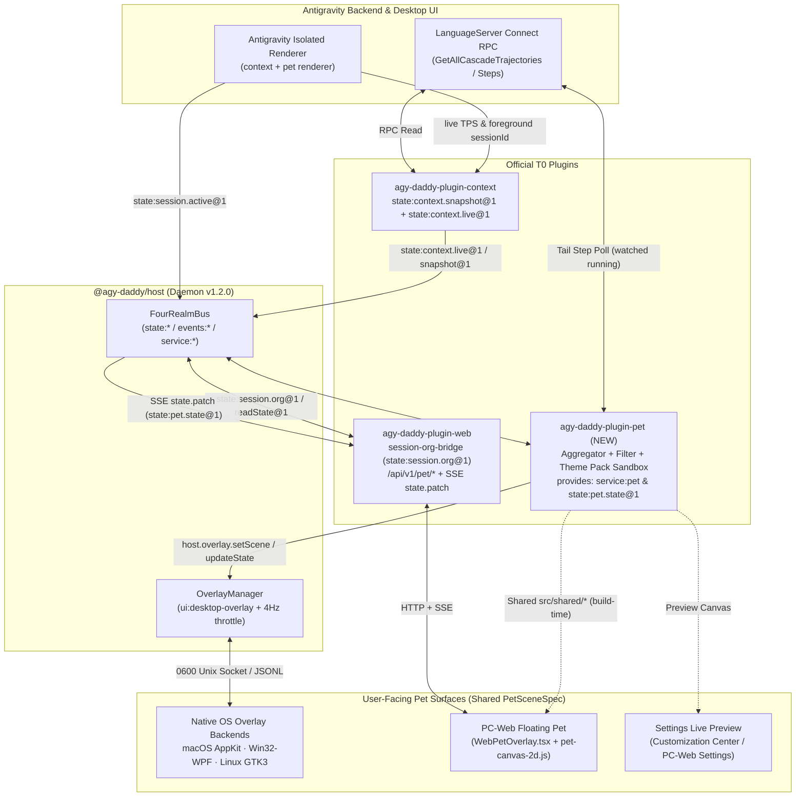
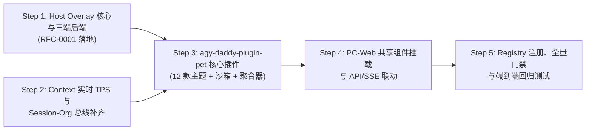

# Agy-Daddy 桌面与 PC-Web 伴侣宠物插件（`agy-daddy-plugin-pet`）架构设计与实施计划

> 状态：**需求范围已锁定 · Host RFC-0001 已配套输出 · 跨端契约与分阶段实施计划定稿**
> 关联 Issue：`HUB-303`
> 关联 RFC：[`agy-daddy-.github/rfcs/0001-desktop-overlay-window.md`](../../agy-daddy-.github/rfcs/0001-desktop-overlay-window.md)

---

## 1. 已锁定产品与合规决策摘要

| 维度 | 锁定决策 | 架构落地准则 |
|---|---|---|
| **渲染载体** | **方案 B（三端原生轻量透明 Always-on-Top 置顶窗）+ 同步支持 `pc-web` 页面内悬浮** | 宿主侧按 RFC-0001 新增 `OverlayManager` 与三端无 WebView 轻量矢量/精灵后端（`<30 MB` 驻留内存）；`agy-daddy-plugin-web` 通过共享声明式骨骼与 `Path2D` Canvas 渲染器在工作台内同步渲染 |
| **主题与开源合规** | **12 款（11 款需求原型 + 1 款宿主强调色默认款）全部采用 MIT 原创致敬风格矢量动画 + 支持本地导入自定义形象包** | 严格遵守 `LICENSE_AUDIT.md` 第 4.2 条 Clean-Room 规则，零商业商标/版权位图；本地导入仅接受纯数据 `PetThemeManifest v1` + 静态图像/净化 SVG，严禁任何可执行脚本 |
| **速率与状态联动** | **游走速度与动作帧率实时绑定会话流式 `tokens/s`（TPS），同时提示「待审核项」与「新回复项」** | 补齐 `agy-daddy.context` 流式周期 `state:context.live@1` 广播，并在 `agy-daddy.pet` Node 端提供 `GENERATING` 步骤增量估算兜底，确保桌面端、后台会话与 `pc-web` 对话均具备毫秒级 TPS 调速 |
| **多会话过滤策略** | **支持配置「跟随当前会话」「排除当前会话」「指定项目白名单」「分组白名单」** | 扩展 `session-org-bridge.js` 的 `state:session.org@1` 摘要以暴露完整 `projects[]` 与 `sessionGroupMap`，实现零额外权限的跨插件项目/分组白名单匹配 |
| **工程门禁约束** | **100% 零第三方运行期依赖（`dependencies: {}`）+ 紫色主题静态门禁（Purple Theme Gate）** | 界面控件统一使用 `--ag-custom-token-accent`；所有内置主题色板避开 `scripts/monorepo.js` 禁用的 9 个硬编码色值并纳入单测 |

---

## 2. 总体系统架构与数据流

### 2.1 模块拓扑图



### 2.2 关键架构发现与根因闭环

1. **流式 TPS 实时性闭环（重要发现）**：
   - 现状核查发现 `agy-daddy-plugin-context/src/renderer.js` 的 `sampleLiveStreaming()`（`400ms` 采样）仅更新页面内胶囊 DOM，**流式生成期间并未向 `FourRealmBus` 推送实时 `tps`**，直到整轮生成结束（`completed === true`）才触发 `/rescan` 写入 `state:context.snapshot@1`。
   - **架构方案（双源融合）**：
     1. 在 `agy-daddy-plugin-context` 新增轻量总线状态 `state:context.live@1`（仅在 `phase`/`tps` 变化且间隔 `>= 300ms` 时发出 `{ cascadeId, busy, phase, tps, ttft, estimatedOutputTokens, updatedAt }`），桌面端前台对话零额外 RPC 直接驱动桌宠实时加速。
     2. 当用户开启「排除当前会话」、监听后台子代理、或关闭桌面窗口仅在 `pc-web` 对话时，`agy-daddy.pet` 的 `SessionWatchAggregator` 对处于 `CASCADE_RUN_STATUS_RUNNING` 的被监听会话按 `500ms` 增量拉取尾部 2 步（`GetCascadeTrajectorySteps` 带 `stepOffset: Math.max(0, stepCount - 2)`，实测耗时 `< 5ms`），用与 `stream-speed-tracker.js` 同构的 CJK/ASCII 滑动窗口公式实时计算后台流式 `tps`。
2. **`state:session.org@1` 元数据补齐（免越权文件读取）**：
   - 现状核查发现 `agy-daddy-plugin-web/src/session-org-bridge.js`（以及 `plugin-remote` 同构副本）的 `buildOrgBusSummary()` 仅发布了 `groups` 与 `projectGroupMap`，未包含 `projects[]`（含 `id`、`aliases`、`name`、`rootPath`、`uri`）与 `sessionGroupMap` / `sessionProjectOverrides`。
   - **架构方案**：在 `buildOrgBusSummary()` 向后兼容补齐精简版 `projects`、`sessionGroupMap`、`sessionProjectOverrides`。`agy-daddy.pet` 仅凭总线订阅即可完成 `workspaceUri -> projectId -> groupId` 映射与设置页白名单下拉选项渲染，日常运行无需申请常驻 `fs:user-files` 扫描 `~/.agy-daddy/session-org.json`。

---

## 3. 跨插件总线契约与过滤规则规范

### 3.1 新增与扩展的总线状态/服务清单

| 契约标识 | 类型 & Realm | 提供方 (`provides`) | 消费方 (`consumes` / `subscribe`) | 载荷摘要与用途 |
|---|---|---|---|---|
| `state:context.live@1` | State | `agy-daddy.context` | `agy-daddy.pet`, `agy-daddy.web` (SSE) | `{ cascadeId, busy, phase: 'waiting'\|'streaming'\|'idle', tps: number\|null, ttft: number\|null, updatedAt }` |
| `state:session.org@1` | State (向后兼容扩展) | `agy-daddy.web` / `agy-daddy.remote` | `agy-daddy.pet` | 在既有字段基础上新增 `projects: Array<{ id, aliases, name, rootPath, uri, groupId }>`、`sessionGroupMap`、`sessionProjectOverrides` |
| `state:session.active@1` | State | `agy-daddy.pet` (renderer + web sync) | `agy-daddy.pet` (node) | `{ desktopSessionId, desktopBusy, webSessionId, activeSurface: 'desktop'\|'pc-web', updatedAt }` |
| `state:pet.state@1` | State | `agy-daddy.pet` | `agy-daddy.web` (自动转推 SSE `state.patch`), `agy-daddy.pet` (renderer) | 归一化后的桌宠实时运动档位、TPS、当前气泡（待审核/新回复）、可用主题列表与双端开关状态 |
| `service:pet` (`1.0.0`) | Service (`node`) | `agy-daddy.pet` | `agy-daddy.web`, `agy-daddy.remote` (optional) | `getSnapshot()`, `getThemeRig(themeId)`, `listThemes()`, `setActiveWebSession(cascadeId)`, `handleInteraction(action)`, `importThemePack(payload)`, `deleteCustomTheme(themeId)` |

### 3.2 `state:pet.state@1` 标准数据结构

```ts
export interface AttentionItem {
  id: string;                // "${cascadeId}:${stepIndex}:${kind}"
  kind: 'approval' | 'reply' | 'error';
  cascadeId: string;
  sessionTitle: string;
  projectId: string | null;
  projectName: string | null;
  groupId: string | null;
  stepIndex: number;
  interactionType?: string;  // e.g. 'runCommand' | 'filePermission' | 'mcp' | 'askQuestion'
  summary: string;           // 纯文本安全截断 <= 80 字符
  createdAt: number;
}

export interface PetBusStateV1 {
  enabled: boolean;
  desktopVisible: boolean;
  webVisible: boolean;
  themeId: string;
  petScale: number;
  roamMode: 'none' | 'bottom-edge' | 'screen-edges' | 'free-workarea';
  webAnchor: { xRatio: number; yRatio: number }; // 独立于 OS 桌面坐标的浏览器视口比例坐标
  motion: {
    animState: 'sleeping' | 'idle' | 'thinking' | 'walking' | 'trotting' | 'sprinting' | 'approval' | 'error';
    tps: number | null;
    speedFactor: number;     // [0.25, 3.5]，经指数移动平均（EMA alpha=0.35）平滑防抖
    primarySessionId: string | null;
    primarySessionTitle: string;
    watchedRunningCount: number;
  };
  attention: {
    pendingApprovals: AttentionItem[]; // 优先级最高：存在待审核项时常驻气泡直至处理或忽略
    unreadReplies: AttentionItem[];    // 次优先级：新回复完成时弹出气泡（默认 12s 自动收起或点击聚焦清零）
    activeBubble: AttentionItem | null;
  };
  orgCatalog: {
    projects: Array<{ id: string; name: string }>;
    groups: Array<{ id: string; name: string }>;
  };
  updatedAt: number;
}
```

### 3.3 待审核项（Approval）与新回复项（Reply）精确判定契约

复用并对齐 `agy-daddy-plugin-web/src/harness-adapter.js` 已验证的轨迹步骤语义：

1. **待审核项（`kind: 'approval'`）**：
   - 会话尾部步骤满足 `step.status === 'CORTEX_STEP_STATUS_PENDING'`（或 `WAITING`），且命中以下任一条件：
     - `step.requestedInteraction`（或其内层 `.interaction`）包含 `CONFIRM_INTERACTION_FIELDS` 任一字段（`approvalInteraction`、`mcp`、`openBrowserUrl`、`executeBrowserJavaScript`、`captureBrowserScreenshot`、`clickBrowserPixel`、`readUrlContent`、`sendCommandInput`）、`filePermission`、`runCommand`、`permission`；
     - `step.type === 'CORTEX_STEP_TYPE_ASK_QUESTION'` 且 `!Array.isArray(step.completedInteractions) || step.completedInteractions.length === 0`。
   - 当对应步骤状态变为 `DONE`/`RUNNING`/`CANCELED` 或用户在任一端审批后，该 `AttentionItem` 自动从队列移除，双端气泡即时同步消失。
2. **新回复项（`kind: 'reply'`）**：
   - 被监听会话由 `CASCADE_RUN_STATUS_RUNNING` 转为 `CASCADE_RUN_STATUS_IDLE`（或最新完成的 `CORTEX_STEP_TYPE_PLANNER_RESPONSE` 步骤序号 `stepIndex > lastAckedStepIndex[cascadeId]`），提取 `modifiedResponse || response` 首行纯文本摘要（去 Markdown 符号，截断 68 字）生成 `reply` 提醒。
   - **联动已读消隐**：订阅 `state:session.readState@1`——一旦用户在桌面端或 `pc-web` 阅读了该会话（`readStepCount >= stepCount`）或点击气泡「查看/忽略」，立即清除该条 `reply`。

### 3.4 四维会话监听过滤器（确定性布尔真值表）

插件 `settings.schema.json` 暴露以下 4 个过滤字段：
- `followCurrentSession`（`boolean`，默认 `true`）：优先跟随当前焦点会话（桌面端当前会话或 `pc-web` 当前打开会话）。
- `excludeCurrentSession`（`boolean`，默认 `false`）：强制排除当前焦点会话（适合「只盯后台任务与子会话、不打扰眼前正在看的对话」场景）。
- `projectWhitelist`（`list<string>`，默认 `[]`）：指定监听的项目 ID 白名单（支持匹配 `project.id`、`project.aliases` 或规范化工作区路径）。
- `groupWhitelist`（`list<string>`，默认 `[]`）：指定监听的分组 ID 白名单（通过 `sessionGroupMap[cascadeId] || projectGroupMap[projectId]` 解析）。

**单会话判定函数 `isSessionWatched(session)`（严格按序求值）**：

1. **生命周期剔除**：若命中 `deletedSessions[id]`、`archivedSessions[id]` 或 `session.isSubagent === true`，直接返回 `false`。
2. **最高优硬排除**：若 `excludeCurrentSession === true` 且 `session.cascadeId === currentFocusSessionId`，直接返回 `false`（覆盖跟随与白名单）。
3. **白名单求值**：令 `hasWhitelist = projectWhitelist.length > 0 || groupWhitelist.length > 0`：
   - 若 `hasWhitelist === true`：令 `inWhitelist = (projectWhitelist.includes(projectId)) || (groupWhitelist.includes(groupId))`（项目白名单与分组白名单取**并集**，避免选了分组 A 又补选独立项目 B 时交集为空）。当 `inWhitelist === true` 时返回 `true`；若 `followCurrentSession === true && session.cascadeId === currentFocusSessionId` 亦返回 `true`，其余返回 `false`。
   - 若 `hasWhitelist === false`（未设白名单）：所有非归档顶层会话均纳入后台审核/新回复气泡感知池；其中当 `followCurrentSession === true` 且焦点会话活跃时，桌宠运动速率优先绑定焦点会话 TPS，焦点会话闲置时自动回退反映后台最快运行中会话的 TPS。

### 3.5 TPS → 游走速度与动画帧率映射曲线

采用对数平滑 + 指数移动平均（EMA, $\alpha = 0.35$）消除网络分块抖动：

$$\text{rawFactor}(\text{tps}) = \text{clamp}\left(1.0 + 0.75 \cdot \log_2\left(1 + \frac{\max(0, \text{tps})}{15}\right),\ 1.0,\ 3.5\right)$$

| 会话运行态 | 实时 TPS 区间 | `animState` 档位 | `speedFactor` | 桌面/网页游走线速度 | 渲染目标帧率 |
|---|---|---|---|---|---|
| 闲置 `> 45s` | `0` | `sleeping`（打盹小憩） | `0.35` | `0 px/s`（原地呼吸） | `4 FPS`（极低功耗） |
| 闲置 `<= 45s` | `0` | `idle`（待命东张西望） | `0.80` | `0–14 px/s`（偶发慢踱） | `12 FPS` |
| 等待首字（TTFT） | `null`（`busy=true`） | `thinking`（歪头思考脉冲） | `1.00` | `18 px/s` | `20 FPS` |
| 低速流式生成 | `1 – 25 tok/s` | `walking`（轻快漫步） | `1.05 – 1.60` | `32 – 55 px/s` | `30 FPS` |
| 中速流式生成 | `25 – 65 tok/s` | `trotting`（小跑巡视 + 粒子） | `1.60 – 2.35` | `55 – 95 px/s` | `30 FPS` |
| 高速流式生成 | `> 65 tok/s` | `sprinting`（全力冲刺 + 尾迹） | `2.35 – 3.50` | `95 – 150 px/s` | `30 FPS` |
| 待人工审核 | 任意 | `approval`（原地欢跳招手 + 常驻气泡） | `1.40` | `0 px/s`（停稳防误点拖拽） | `24 FPS` |
| 异常中断 | 任意 | `error`（眩晕抖动 + 告警气泡） | `1.00` | `0 px/s` | `20 FPS` |

> **关键交互细节**：当存在 `pendingApprovals` 或用户鼠标悬停在桌宠/气泡区域（`hover`）时，桌宠**自动暂停水平位移**（保持动作动画但不逃离鼠标指针），防止用户正要点击「查看审核项」时窗口游走导致点空。

---

## 4. 12 款 MIT 原创致敬主题规格与门禁色板规范

所有内置主题 100% 由纯代码声明式几何矢量图层（`OverlaySceneSpec`）实现，单主题体积 `< 4 KB`，总包体增量 `< 50 KB`，零外部字体与位图依赖。

| 序号 | 主题 ID | 中文名 / 英文名 | 原创致敬设计（Clean-Room MIT） | 专属粒子预设 |
|---|---|---|---|---|
| 1 | `daddy-orb` *(默认)* | 紫晶脉冲灵 / Agy Pulse Sprite | 跟随宿主 `--ag-custom-token-accent` 强调色的悬浮双环几何核心小精灵 | `sparks` |
| 2 | `abyssal-whale` | 深海算力鲸 / Abyssal Whale | 深海钴蓝渐变（`#2563eb` → `#60a5fa`）流线圆润小鲸鱼，流式吐字时头顶喷出跃动水珠 | `bubbles` |
| 3 | `sunny-sponge` | 阳光海绵块 / Sunny Sponge | 波浪边明黄（`#facc15`）多孔海绵方块精灵，灵动大眼眨动与开心咧嘴，游走冒肥皂泡 | `bubbles` |
| 4 | `nimble-mouse` | 机灵芝士鼠 / Nimble Mouse | 暖褐圆耳小仓鼠（`#b45309` / `#fde68a`），待机抱奶酪轻晃，高速流式时四爪残影奔跑 | `sparks` |
| 5 | `aegis-visor` | 赤金机甲盔 / Aegis Visor | 原创多切面钛红赤金（`#dc2626` / `#eab308`）科幻面甲，眼部窄缝带冰蓝 `#67e8f9` HUD 扫描光 | `sparks` |
| 6 | `cyber-neko` | 霓虹义体猫 / Cyber Neko | 暗曜石黑紫（`#1e1b4b` / `#c084fc`）机械耳小猫，单侧全息绿青瞄准镜与光纤摆尾 | `matrix` |
| 7 | `arcade-chomp` | 街机像素豆 / Arcade Chomp | 8-bit 阶梯像素网格几何圆豆与像素小怪伴飞，游走张合嘴角吞食像素能量点 | `pixels` |
| 8 | `astro-shiba` | 星航柴犬 / Astro Shiba | 球形高光透明太空罩暖柴犬（`#d97706` / `#fef3c7`），背部双喷口随 TPS 喷出蓝紫尾焰 | `exhaust` |
| 9 | `vapor-dolphin` | 蒸汽波海豚 / Vapor Dolphin | 霓虹洋红至电光紫（`#ec4899` → `#8b5cf6`）跃浪海豚，底座带复古落日横纹与透视网格 | `stars` |
| 10 | `cli-phantom` | 终端光标灵 / CLI Phantom | 半透明暗黑终端面板小幽灵，胸口闪烁 `>_` 复古荧光绿（`#22c55e`）光标与字符雨 | `matrix` |
| 11 | `graffiti-cub` | 街头涂鸦熊 / Graffiti Cub | 圆耳潮玩关节小熊剪影，不对称波普撞色（`#f43f5e` / `#8b5cf6` / `#eab308`）几何涂鸦胸章 | `pixels` |
| 12 | `arcane-cat` | 奥术黑猫 / Arcane Cat | 歪尖顶星月紫巫师帽（`#6d28d9`）金瞳黑猫，爪持发光法杖挥洒金色四角星芒 | `stars` |

> **Purple Theme Gate 强制红线**：所有插件源码（含主题定义文件）严禁出现 `scripts/monorepo.js` 拦截的 9 个色值（`#10b981`, `#34d399`, `#059669`, `#38bdf8`, `#7dd3fc`, `#0369a1`, `#0c4a6e`, `#fb923c`, `#c2410c`）。UI 容器、按钮、气泡强调边框统一使用 `var(--ag-custom-token-accent, var(--ag-token-accent-default, #a78bfa))`。

---

## 5. 本地自定义形象包格式（`PetThemeManifest v1`）与安全沙箱边界

用户可通过 `listenhub` CLI、`magnific` 或任意绘图工具制作自定义矢量或位图精灵形象包并一键导入。

### 5.1 包目录结构（支持 `.agypet` / `.tar` 归档或单文件 `.json`）

复用宿主内置零依赖 `agy-daddy-host/src/core/tar.js` 解包（严禁引入外部解压依赖）：

```text
my-custom-pet.agypet (POSIX tar archive)
├── pet-theme.json          # 必填，<= 128 KB，纯声明式主题清单
├── preview.png             # 选填，<= 256 KB
└── sprites/                # 选填（位图帧模式），合计 <= 30 张静态图
    ├── idle.png            # 横向条带精灵图或单帧 PNG/WebP/GIF
    ├── walk.png
    └── sprint.png
```

### 5.2 六层导入安全校验（`src/theme-pack-sandbox.js`）

1. **零代码执行铁律**：包内凡出现 `.js`、`.mjs`、`.cjs`、`.ts`、`.wasm`、`.html`、`.htm`、`.sh`、`.ps1`、`.bat` 等后缀文件，直接整包拒绝（返回错误码 `UNSAFE_PACK_FILE_TYPE`）。
2. **归档炸弹与配额防御**：
   - 单个导入请求体 `<= 5 MB`，解压累计字节数 `<= 12 MB`，条目数 `<= 32`；
   - 自定义主题落盘于 `~/.agy-daddy/plugin-data/agy-daddy.pet/custom-themes/<slug>/`（仅需默认 `fs:plugin-data` 权限），上限 `20` 款自定义主题。
3. **路径穿越与符号链接阻断**：拒绝包含 `..`、绝对路径前缀 `/` 或 `\`、空字节 `\0` 的归档条目；拒绝 tar `typeflag` 为符号链接（`'2'`）、硬链接（`'1'`）或设备节点的条目；落盘后二次校验 `fs.realpathSync(file).startsWith(realCustomThemesDir + path.sep)`。
4. **图像魔数与尺寸头校验**：不信任文件扩展名，直接读取二进制头部校验 PNG（`89 50 4E 47 0D 0A 1A 0A` + `IHDR` 宽高 `<= 512×512`）、WebP（`RIFF....WEBP` + `VP8 ` / `VP8L` / `VP8X` 宽高 `<= 512×512`）、GIF（`GIF87a`/`GIF89a` 宽高 `<= 512×512`）。
5. **Zero-Script SVG 净化器**：若自定义包提供静态 `.svg` 图层，仅提取纯几何 `<path d="...">` / 基础图形属性并验证 `d` 仅含 `[MLHVCSQTAZmlhvcsqtaz0-9.,\s+-]`；凡含 `<script`、`<foreignObject`、`on[a-z]+\s*=`、`javascript:`、`data:text/html`、`http://`、`https://`、`@import` 立即拒绝（`UNSAFE_SVG_CONTENT`）。
6. **权限最小化**：
   - `pc-web` 与设置中心优先走浏览器 `<input type="file">` 读取字节流经本地 HTTP/Bridge 上传至 `service:pet.importThemePack({ archiveBase64, fileName })`，**全程无需 `fs:user-files` 高危权限**。
   - CLI / 命令面板额外提供可选 `pet.importFromPath` 命令（仅在传入本地路径时按需校验路径可读性）。

---

## 6. 桌面浮窗与 `pc-web` 共享渲染组件及双端交互同步方案

### 6.1 单一真相源渲染管线（`agy-daddy-plugin-pet/src/shared/`）

为同时满足「`package.json` 零运行期依赖」「桌面三端原生无 WebView 极轻运行」「`pc-web` 页面内丝滑同款渲染」，将纯算法与 Canvas 组件沉淀在 `agy-daddy-plugin-pet/src/shared/`（零 Node 专属模块、零 React 耦合）：

1. **`src/shared/pet-rig-evaluator.js`**：
   - 输入：`(sceneSpec, runtimeState, timestampMs)`
   - 输出：当前帧各图层的仿射变换矩阵 `{ tx, ty, rotRad, scaleX, scaleY, opacity }` 与活跃粒子数组 `particles[]`。
   - `pc-web` 直接在浏览器 `requestAnimationFrame` 中调用；桌面端原生后端（Swift / WPF / GTK3）实现完全等价的 40 行正余弦轨道插值公式，保证双端动作节奏分毫不差。
2. **`src/shared/pet-canvas-stage.js`**：
   - 原生 HTML5 `<canvas>` + 预编译 `Path2D` 缓存 + 离屏精灵图 `ImageBitmap`/`HTMLImageElement` 渲染器（支持 `devicePixelRatio` 高清屏自适应与帧率节流器 `4/12/20/30 FPS`）。
   - 同时挂载在两处 Web 视图：
     - **`agy-daddy-plugin-web/web/src/pet/WebPetOverlay.tsx`**：Vite 构建期直接打包引用 `../../../agy-daddy-plugin-pet/src/shared/pet-canvas-stage.js`（编译进 `agy-daddy-plugin-web/dist/web/` 静态产物，不产生运行期跨包 npm 依赖）。
     - **桌面端 Antigravity 设置预览 / 顶栏快捷浮窗（`agy-daddy-plugin-pet/src/renderer.js`）**：在插件卡片内实时预览 12 款内置主题与已导入自定义主题。

### 6.2 `pc-web` 页面内悬浮交互与双端同步矩阵

1. **`pc-web` 挂载点与指针穿透**：
   - 在 `agy-daddy-plugin-web/web/src/App.tsx` 根容器内挂载 `<WebPetOverlay />`：外层游走轨道层 `position: fixed; inset: 0; pointer-events: none; z-index: 90`，仅桌宠碰撞盒（`hitBox`）与气泡卡片设为 `pointer-events: auto`，绝不遮挡三栏编辑器、Composer 输入框或右栏 Dock 点击。
   - 支持指针拖拽（Pointer Events `setPointerCapture`）自由移动位置並吸附视口边缘，位置以归一化视口比例 `{ xRatio, yRatio }` 存入 `webAnchor`，适配不同窗口尺寸且**与 OS 桌面像素坐标互不覆盖**。
2. **后端路由与权限级别（`agy-daddy-plugin-web/src/web-server.js` & `host-proxy.js`）**：
   - `WEB_RELEVANT_PLUGIN_POLICY` 注册 `'agy-daddy.pet': { mode: 'all', reason: 'Desktop & PC-Web companion pet, themes, and session watch filters' }`，使 `pc-web` 设置抽屉自动渲染完整桌宠设置表单（含开关、主题切换、游走模式、项目/分组白名单多选）。
   - `GET /api/v1/pet/state`（`L0`）：返回 `{ available, state, scene, customAssets }`。
   - `POST /api/v1/pet/interact`（聚焦/忽略气泡/更新 `webAnchor` 为 `L0`；导入/删除自定义主题包为 `L1` 且经 Cloudflare 隧道时校验 `X-Agy-Confirm`）。
3. **双端实时同步行为表**：

| 用户操作触发端 | 同步链路 | 桌面原生置顶窗响应 | `pc-web` 页面内悬浮宠响应 |
|---|---|---|---|
| 任一端切换主题 / 缩放 / 过滤白名单 | `settings.update` → `state:pet.state@1` → SSE `state.patch` | `OverlayManager.setScene()` 即时换肤 | `<WebPetOverlay />` 即时换肤 |
| 点击「待审核 / 新回复」气泡（在 `pc-web`） | 前端调用 `selectSession(bubble.cascadeId)` 切至该会话并滚动到底部 + `POST /api/v1/pet/interact { action: 'ack-bubble' }` | 收到 `ack-bubble` 后桌面气泡同步消隐 | 当前页直接打开目标会话审批卡，气泡消隐 |
| 点击「待审核 / 新回复」气泡（在 OS 桌面） | Helper 发 `bubble-click` → `service:pet` 激活 Antigravity 窗口并广播 `pet:focus-session@1`（若桌面未连接 CDP 且 `pc-web` 在线则打开 `pc-web` 对应会话 URL） | 窗口跳转至前台对应会话，气泡消隐 | SSE 收到 `state:pet.state@1` 更新，网页端气泡同步消隐 |
| 单独关闭「在 PC-Web 显示」（`webVisible=false`） | `settings.update({ webVisible: false })` | **继续保持桌面置顶悬浮** | 页面内悬浮宠立即卸载隐藏 |
| 单独关闭「在桌面置顶显示」（`desktopVisible=false`） | `settings.update({ desktopVisible: false })` | **立即终止原生 Overlay 子进程（0 内存）** | **继续在 `pc-web` 页面内正常显示与游走** |

---

## 7. 分阶段可执行实施计划（含输入/输出/依赖/验收标准）

> 按单一仓库可验证增量提交组织，遵守 `CONTRIBUTING.md` 全部 8 项静态门禁与 TDD 规范。



### Step 1：落地 `@agy-daddy/host` 透明置顶窗核心与三端原生后端（依赖：无）
- **涉及文件**：
  - 修改：`agy-daddy-host/src/contracts/constants.js`、`agy-daddy-host/src/contracts/manifest-validator.js`、`agy-daddy-host/sdk/index.d.ts`、`agy-daddy-host/sdk/mock-harness.js`
  - 修改：`agy-daddy-host/src/core/daemon.js`、`agy-daddy-host/src/core/plugin-worker.js`
  - 新增：`agy-daddy-host/src/core/overlay-manager.js`
  - 新增：`agy-daddy-host/src/core/overlay-backends/{macos-overlay.swift,win32-overlay.ps1,linux-overlay.py}`
  - 新增：`agy-daddy-host/test/{overlay-manager.test.js,overlay-backends.test.js}`
- **输入**：`RFC-0001` 规范与现有 `tray-manager.js` 进程监管模式。
- **输出**：完整可用的 `host.overlay` API（含 `MemoryOverlayBackend`、尺寸/频率/路径沙箱、Worker IPC 透传、`assertCleanDispose` 泄漏断言及三端原生透明点击穿透后端）。
- **验收标准**：
  - `AGY_DADDY_TEST_MODE=1 node --test agy-daddy-host/test/overlay-*.test.js` 全绿；
  - macOS 下 `swiftc -typecheck macos-overlay.swift` 与 `python3 -m py_compile linux-overlay.py` 零报错；
  - 未启用 `ui:desktop-overlay` 的插件调用 `host.overlay.createWindow()` 抛出明确权限拒绝错误。

### Step 2：补齐跨插件实时流式 TPS 与项目/分组白名单总线契约（依赖：无，可与 Step 1 并行）
- **涉及文件**：
  - 修改：`agy-daddy-plugin-context/agy-plugin.json`、`agy-daddy-plugin-context/src/renderer.js`、`agy-daddy-plugin-context/src/node.js`、`agy-daddy-plugin-context/test/*.test.js`
  - 修改：`agy-daddy-plugin-web/src/session-org-bridge.js`、`agy-daddy-plugin-remote/src/session-org-bridge.js`（若存在共享/同步逻辑则对齐 `buildOrgBusSummary`）及对应 `session-org-v2.test.js`
  - 修改：`agy-daddy-registry/registry.json`（同步刷新 `agy-daddy.context` 的 `manifestSha512`）
- **输入**：现有 `stream-speed-tracker.js` 与 `session-org-bridge.js`。
- **输出**：流式生成期间按 `>=300ms` 节流广播 `state:context.live@1`；`state:session.org@1` 包含 `projects[]`（含 `id`、`aliases`、`name`、`rootPath`、`uri`、`groupId`）与 `sessionGroupMap`、`sessionProjectOverrides`。
- **验收标准**：
  - 流式采样单测断言生成中 `state:context.live@1` 实时输出非空 `tps`，生成结束后归零；
  - `session-org-v2.test.js` 断言 `state:session.org@1` 包含完整项目与会话分组映射且向后兼容旧消费者。

### Step 3：新建官方插件 `agy-daddy-plugin-pet`（依赖：Step 1 + Step 2）
- **涉及文件**：
  - 新增包：`agy-daddy-plugin-pet/{package.json,agy-plugin.json,settings.schema.json,LICENSE,README.md}`
  - 新增共享渲染内核：`agy-daddy-plugin-pet/src/shared/{pet-rig-evaluator.js,pet-canvas-stage.js,themes.js}`（内置全部 12 款 MIT 原创致敬主题）
  - 新增插件运行端：`agy-daddy-plugin-pet/src/{node.js,renderer.js,session-watch-aggregator.js,theme-pack-sandbox.js}`
  - 新增多语言：`agy-daddy-plugin-pet/locales/{zh-CN.json,en.json}`
  - 新增测试：`agy-daddy-plugin-pet/test/{aggregator-filter.test.js,theme-pack-sandbox.test.js,themes-gate.test.js,plugin-lifecycle.test.js}`
- **输入**：`host.overlay`、`state:context.live@1`、`state:session.org@1` 与 `GetAllCascadeTrajectories` / `GetCascadeTrajectorySteps` RPC。
- **输出**：完整的桌面宠物守护逻辑、四维会话过滤器、待审核/新回复聚合队列、自定义 `.agypet` 包六层安全导入器、12 款矢量主题、顶栏/托盘快捷切换与桌面设置实时预览。
- **验收标准**：
  - 覆盖四维过滤器（跟随当前 / 排除当前 / 项目白名单 / 分组白名单）全部 8 种组合真值表的单测 100% 通过；
  - 安全沙箱单测验证含 `.js`、路径穿越 `../`、symlink、`<script>` SVG、伪造魔数超尺寸图片均被精确拦截；
  - 12 款内置主题通过 `FORBIDDEN_THEME_REGEXES` 扫描且 `harness.assertCleanDispose('agy-daddy.pet')` 零资源泄漏。

### Step 4：集成 `agy-daddy-plugin-web`（`pc-web`）页面内悬浮宠与双端同步（依赖：Step 3）
- **涉及文件**：
  - 修改：`agy-daddy-plugin-web/agy-plugin.json`（`consumes` 增加 `pet: { version: "^1.0.0", optional: true }`）
  - 修改：`agy-daddy-plugin-web/src/{host-proxy.js,web-server.js}`（注册 `WEB_RELEVANT_PLUGIN_POLICY['agy-daddy.pet']` 与 `/api/v1/pet/{state,interact}` 路由）
  - 新增：`agy-daddy-plugin-web/web/src/pet/{WebPetOverlay.tsx,WebPetOverlay.module.css,WebPetOverlay.test.tsx}`
  - 修改：`agy-daddy-plugin-web/web/src/{App.tsx,api/client.ts,types.ts,i18n/locales.ts}` 并重新构建 `agy-daddy-plugin-web/dist/web/`
- **输入**：`agy-daddy-plugin-pet/src/shared/*`、`service:pet` 与 SSE `state.patch`。
- **输出**：`pc-web` 页面内无遮挡悬浮桌宠、视口拖拽记忆、点击气泡直跳目标审批/回复会话、PC-Web 设置中心自定义包上传导入与双端已读/消隐实时同步。
- **验收标准**：
  - Vitest 组件测试验证：SSE `state.patch` 推送高 TPS 时帧率档位加速、推送 `approval` 时渲染待审核气泡、点击气泡触发目标 `cascadeId` 聚焦并发送 `ack-bubble`、外层指针完全穿透不阻断 Composer 输入；
  - Web 服务端测试验证 `L0`/`L1` 与 Cloudflare `X-Agy-Confirm` 门禁对自定义包上传路由生效。

### Step 5：注册表与许可证审计同步及全仓验收（依赖：Step 3 + Step 4）
- **涉及文件**：
  - 修改：`agy-daddy-registry/registry.json` & `agy-daddy-host/data/registry.json`（新增 `agy-daddy.pet` 条目，刷新 `agy-daddy.context` 与 `agy-daddy.web` 的 `manifestSha512`）
  - 修改：`agy-daddy-.github/LICENSE_AUDIT.md` & `LICENSE_AUDIT_zh.md`（登记 `agy-daddy-plugin-pet/` MIT 原创资产审计记录）
- **验收标准**：
  - 仓库根目录执行 `npm run verify`（含 `build` + 全部 8 项 `gates` + 全包 `test`）零错误通过；
  - 长时间空闲内存与定时器泄漏检查通过。
